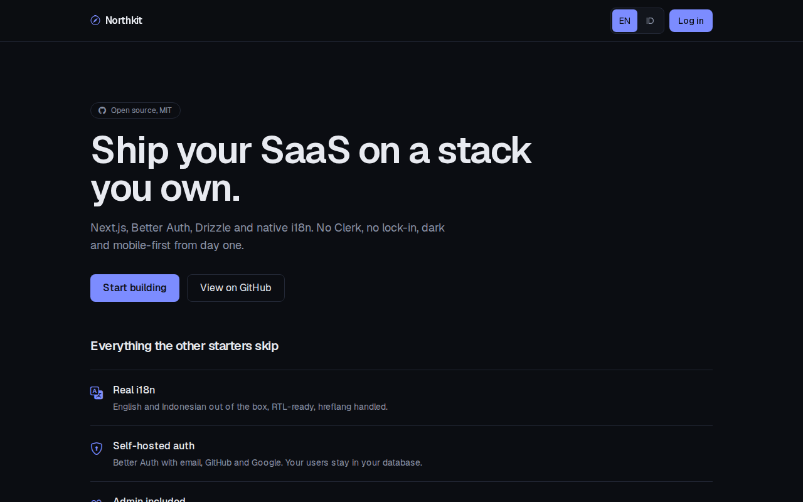
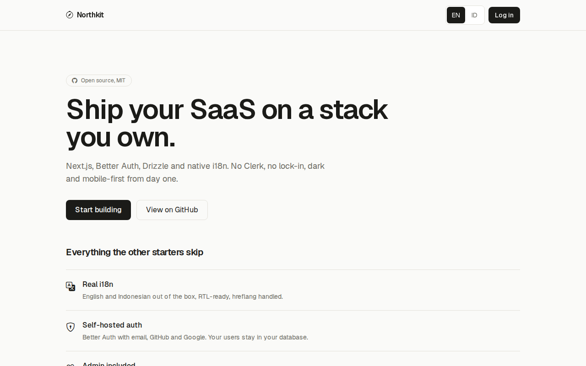
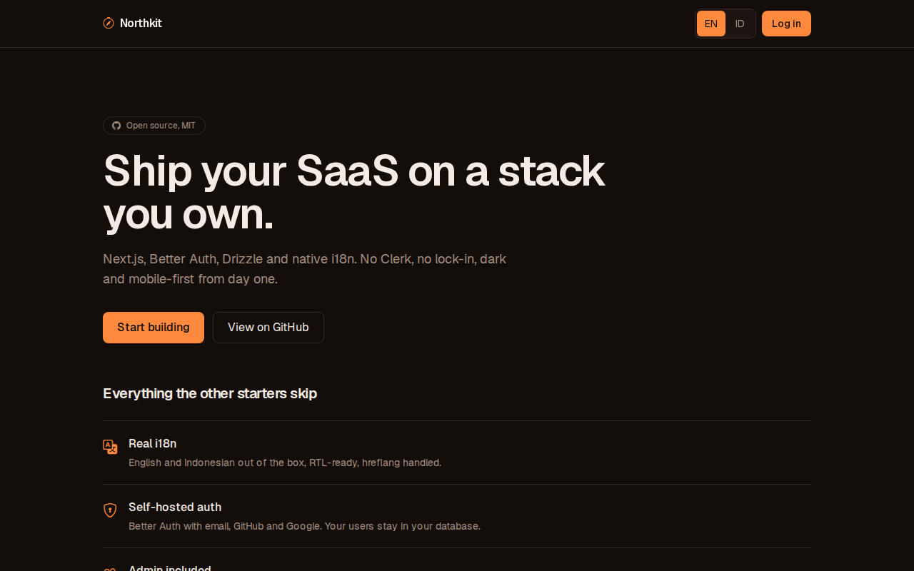
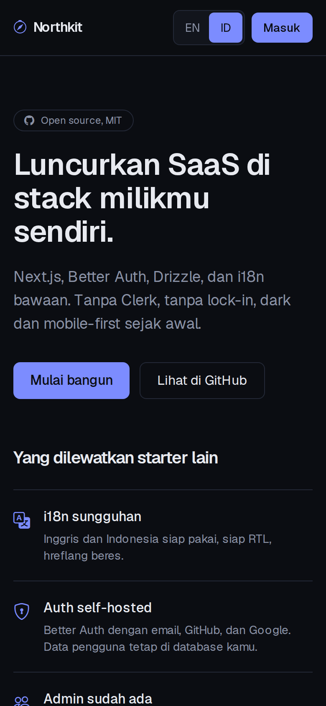

# Northkit

Open-source Next.js starter you fully own: Better Auth, Drizzle + SQLite, native i18n (EN/ID, RTL-ready), three themes, admin panel and SEO basics. No vendor lock-in.



| Paper | Ember | Mobile (ID) |
|---|---|---|
|  |  |  |

Lighthouse (mobile, local production build): Performance 96-99, Accessibility 100, Best Practices 100, SEO 100.

## Quick start

```bash
cp .env.example .env        # set BETTER_AUTH_SECRET: openssl rand -base64 32
npm install
npm run dev
```

Migrations run automatically on start. Open http://localhost:3000. Sign up, then set your user's `role` to `admin` in the `user` table to see `/admin`.

## Stack

Next.js 16, React 19, Tailwind 4, Better Auth (email + optional GitHub/Google), Drizzle ORM, better-sqlite3, next-intl.

## Roadmap

See [ROADMAP.md](./ROADMAP.md).

## License

MIT

## Blog

Write posts as Markdown in `content/blog/<locale>/<slug>.md` with `title`, `description`, `date` frontmatter. They appear at `/<locale>/blog`, in `sitemap.xml` and in `/<locale>/rss.xml`. This is plain Markdown, not MDX (no React components in posts yet).

## Email

Set `SMTP_URL` and `MAIL_FROM` to send password reset and verification emails. Without `SMTP_URL`, links are printed to the server log (dev only). Set `REQUIRE_EMAIL_VERIFICATION=true` to block login until the email is verified.

## Docker

```bash
cp .env.example .env   # set BETTER_AUTH_SECRET and BETTER_AUTH_URL
docker compose up --build
```

Data lives in the `northkit-data` volume. The Docker setup has not been built in CI yet.

## Tests

```bash
npx playwright install chromium
npm run test:e2e
```
